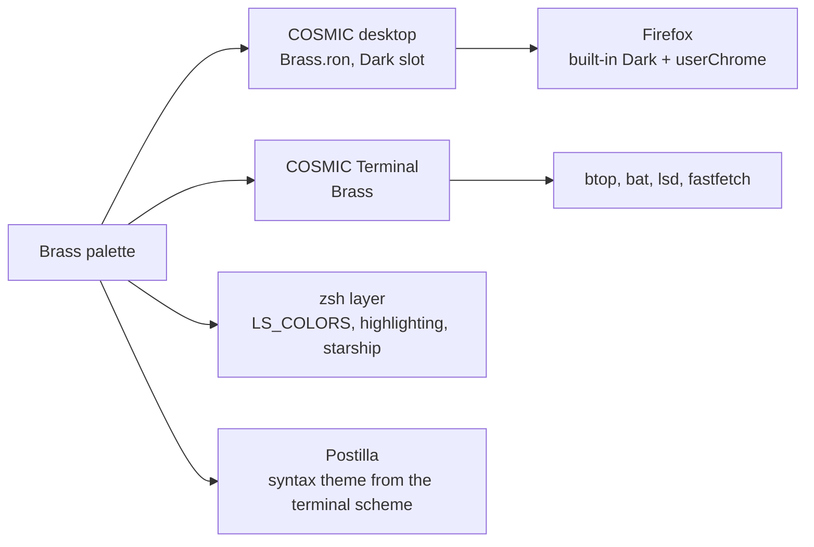

# Brass

> Umber, cream and sand, amber for warmth, brick for what is wrong. Warm metal on dark wood.

Pop!_OS 24.04 on the COSMIC desktop, one palette carried through the whole
machine: desktop, terminal, shell, editor, browser. This note is the rice
describing itself, written in Markdown and rendered by **Postilla**.

## Palette

Every text colour is checked against the window background  `#1C1B19`.

| Role | Hex | Contrast on background |
|------|-----|------------------------|
| Text |  `#F0E4C5` | 13.6:1 |
| Sand, accent |  `#D4BD99` | 9.5:1 |
| Amber, warning |  `#E0905C` | 6.8:1 |
| Brick, error |  `#DD6A5C` | 5.2:1 |
| Tan, success |  `#C2A571` | 7.3:1 |
| Gold, symlinks |  `#E7C07C` | 10.0:1 |
| Clay, directories |  `#A89984` | 6.2:1 |
| Muted |  `#8E8373` | 4.6:1 |

Containers sit one step away from the background at  `#232220`, which is
what frosted glass blurs into.

## Where the colours go



## Setup, in order

- [x] Import `cosmic/Brass.ron` into Appearance, **Dark** slot
- [x] Import `cosmic-term/Brass-term.ron`, pick **Brass** for the profile
- [x] `./icons/install.sh` for the **Cosmic-Brass** icons, `./cosmic/install.sh` for fonts and the terminal look
- [x] `./zsh/install.sh`, `./lsd/install.sh`, `./fastfetch/install.sh`
- [x] Cursor: Oxygen-Brass-Sand
- [x] Wallpaper: `backgrounds/brass-anime.png`
- [ ] Screenshot for the README

## The baseline every rice shares

```ron
corner_radii: (
    radius_xs: (2.0, 2.0, 2.0, 2.0),   // squared corners
    radius_xl: (2.0, 2.0, 2.0, 2.0),
),
frosted: Low,
frosted_windows: true,
frosted_panel: true,
frosted_applets: true,
frosted_maximized_apps: false,
gaps: (0, 4),
active_hint: 1,
```

Contrast is the WCAG ratio[^1], where $L$ is relative luminance:

```typst
$ (L_1 + 0.05) / (L_2 + 0.05) >= 4.5 $
```

---

*Rendered in Postilla, a Markdown notes app for COSMIC. The window is painted
with this rice's terminal scheme, imported as a syntax theme.*

[^1]: Web Content Accessibility Guidelines, success criterion 1.4.3. Normal text wants 4.5:1, large text 3:1.
